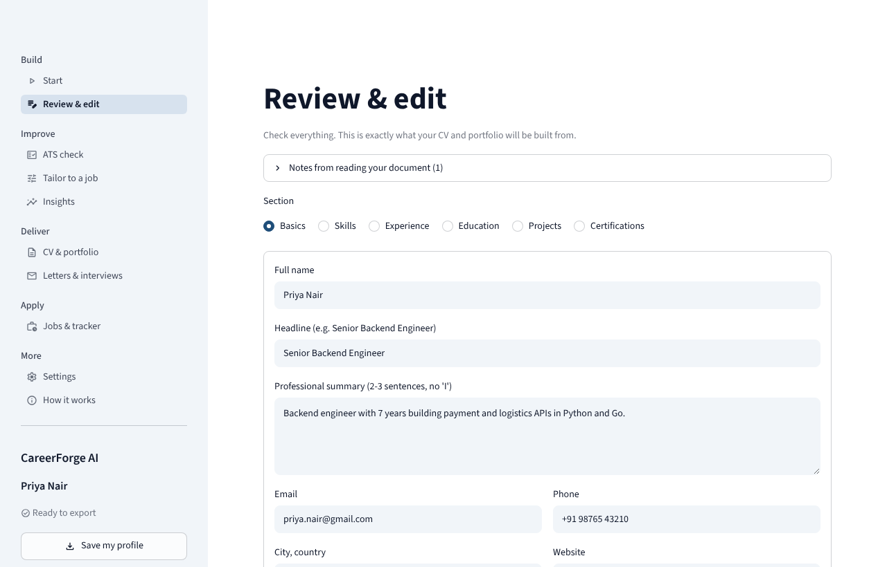

# CareerForge AI

Turn an **old CV, a LinkedIn profile or a GitHub account** into a **ready-to-submit CV and a portfolio website**, check
it against a job posting the way an ATS would, and manage the application. Free to run, runs on Streamlit Community
Cloud, and **never invents experience**.

> One app. It replaces the two earlier projects, *CareerForge AI* (CV builder) and *CareerBoost AI* (ATS, portfolio,
> jobs, outreach), which were audited and merged. See [docs/MERGE_PLAN.md](docs/MERGE_PLAN.md) for what was found and
> how each problem was fixed.



## What you can do

| Step | What it does | Needs AI? |
|---|---|---|
| **Start** | Read a CV (PDF, DOCX, TXT), a LinkedIn *Save to PDF* or *data export* ZIP, pasted text, a GitHub account, or a saved profile | optional |
| **Review & edit** | Correct everything in one place; AI suggestions stay out of your CV until you confirm them; a readiness check lists what blocks submission | no |
| **ATS check** | A transparent 0-100 score against a job posting, or a general ATS-readiness score without one; compare up to 5 postings; section tips | no |
| **Tailor to a job** | Reword your own bullets in the posting's language. New numbers, employers or skills are rejected; new posting terms wait for your decision | yes |
| **Insights** | Career timeline and gaps, skill coverage, keyword heat map, learning roadmap for missing skills | no |
| **CV & portfolio** | 4 CV templates → PDF, Word, text, HTML (the PDF is re-read with an ATS parser so you see how it extracts). A portfolio site (light, dark or automatic) with case studies, an optional CV download, `robots.txt`, `sitemap.xml`, `404.html`, `CNAME` and a free-hosting guide | no |
| **LinkedIn profile** | Your CV rearranged into the text for each part of a LinkedIn profile (headline, About, experience, skills), within LinkedIn's field sizes; only your own words | no |
| **Letters & interviews** | A one-page business-letter cover letter (AI-written and verified, or built without AI from your own bullets) with a lint report and PDF/Word/text; interview questions; outreach drafts for every moment of a search, an e-mail lint, LinkedIn Boolean search (no guessed email addresses) | AI optional for the letter; questions: yes |
| **Jobs & tracker** | Search public boards and any company's Greenhouse/Lever careers page, ranked with a visible breakdown; filters, saved searches, scam warnings; track applications with next actions; follow-up reminders at day 7, 14 and 21 | no |

Without any API key you still get reading (rule-based), the ATS check, insights, outreach drafts, job search, tracker
and every export. AI adds reading messy documents, tailoring, cover letters and interview questions.

## The rules it follows

* **It never invents experience.** AI proposes; plain code verifies. Anything in an AI answer that cannot be found in
  your own text is removed or held for your confirmation. GitHub import gives projects and skills only.
* **It will not export an unfinished CV.** A missing name or email, a sample address (`you@example.com`), leftover
  `[placeholders]`, or an empty profile blocks the download, and says what to fix.
* **The score is arithmetic, not an opinion.** Weights are published in the app (*How it works*). They are design
  choices, **not** fitted to any vendor's ATS; real ATS products are secret and differ. Every report says so.
* **Failures are loud.** If the AI is down, out of quota or returns rubbish, you see a sentence, nothing changes, and
  you can continue with the rule-based reader.

## "Industry standard": what that does and does not mean

The letter, outreach, job-search and portfolio features follow written conventions (one-page business letter of about
250-400 words, short e-mails with one request, WCAG contrast, `robots.txt`) and check your documents against them with
plain code. **No tool can promise that a recruiter, a hiring manager or an ATS will accept a document.** Every rule,
where it comes from and how sure we are is in **[docs/STANDARDS.md](docs/STANDARDS.md)**.

## Quick start

```bash
git clone https://github.com/Shweta-Mishra-ai/CareerForge_AI && cd CareerForge_AI
python -m venv .venv && source .venv/bin/activate
pip install -r requirements.txt
# PDF export needs Pango: macOS `brew install pango`, Debian/Ubuntu `sudo apt install libpango-1.0-0 libpangoft2-1.0-0 libharfbuzz-subset0 fonts-liberation`
streamlit run app.py
```

Python 3.13 is what development and CI use (`pyproject.toml` allows 3.11+, which is untested). Open http://localhost:8501.

### Optional: AI

Free keys: [Google AI Studio](https://aistudio.google.com/apikey) (Gemini) and [Groq](https://console.groq.com/keys).
Either one is enough. Put them in `.streamlit/secrets.toml` (copy `.streamlit/secrets.toml.example`) or in environment
variables, or paste them into **Settings** in the app (kept for that browser session only, never written anywhere).

Free model names change often, so the app **discovers** which models your key can use at runtime. To check what works
right now with *your* keys and get paste-ready settings:

```bash
python -m careerforge.ai.doctor
```

| Setting | Meaning |
|---|---|
| `GEMINI_API_KEY`, `GROQ_API_KEY` | Provider keys |
| `CAREERFORGE_GEMINI_MODELS`, `CAREERFORGE_GROQ_MODELS` | Pin models (comma-separated); skips discovery |
| `CAREERFORGE_SESSION_AI_LIMIT` | AI actions per visitor session when *you* pay for the key (default 30). Visitors who add their own key are unlimited |
| `GITHUB_TOKEN` | Optional; raises GitHub's rate limit for imports |
| `ADZUNA_APP_ID`, `ADZUNA_APP_KEY` | Optional; enables the Adzuna job board |

## Deploy (free)

Streamlit Community Cloud: fork, create the app from `app.py`, paste your secrets. `packages.txt` already lists the
system libraries and fonts that PDF export needs. Full steps: **[docs/DEPLOY.md](docs/DEPLOY.md)**.

## Privacy and security

* Your details live in the visitor's session memory; nothing is stored on a server. *Save my profile* downloads a file
  you keep.
* The app makes **no third-party requests** from the browser (tested): no analytics, no CDN fonts or icons.
* AI text goes only to the provider whose key is configured, and only when you run an AI action. Documents are
  treated as untrusted data (prompt-injection lines are stripped and reported). API keys are redacted from errors.
* Uploaded and generated content is escaped on output; CV previews and the portfolio carry a strict Content Security
  Policy (no scripts, no external resources). Job-posting links are fetched through an SSRF-safe client (public
  addresses only, redirects re-checked, size limits). LinkedIn exports are read from an allow-list of files only.
* GitHub import cannot prove an account is yours (that needs OAuth): only import your own.
* Found a security problem? Please tell the repository owner privately rather than in a public issue.

## How it is built

```
app.py                      entry point (st.navigation)
careerforge/
  models.py                 typed Profile: the single source of truth, with provenance (user/extracted/suggested)
  readiness.py              "is this safe to send?" rules and the export gate
  ingest/                   PDF (column-aware), DOCX, TXT, LinkedIn export, GitHub, SSRF-safe web fetch, rule reader
  ai/                       Gemini + Groq clients, retry/backoff, model discovery, JSON repair, grounding checker
  ats/                      job-posting parser, matcher, scoring report, PDF parse check
  tailor/ writing/          verified rewording, cover letters, interview prep
  render/                   Jinja2 templates, PDF/DOCX/TXT/HTML, portfolio generator and themes
  jobs.py tracker.py ...    job search, application tracker, outreach, roadmap, analytics
  ui/                       state, error messages, widgets and the page modules
chrome_extension/           copies the open LinkedIn profile as text (no network, two permissions)
tests/                      unit, UI (AppTest), and real-browser end-to-end tests
```

## Testing

```bash
pip install -r requirements-dev.txt
playwright install chromium          # once
pytest -m "not live"                 # everything, including browser tests (about 4 minutes)
pytest -m "not live and not e2e"     # fast: no browser
ruff check . && ruff format --check careerforge tests
```

What the suite covers: the scoring and parsing logic with fixtures and mutation-checked assertions; PDF text order on
generated multi-column layouts; the whole Streamlit app headlessly (every page, validation, quotas, hostile input);
and a real browser against a real server for the main journeys, downloads (PDF/DOCX/ZIP re-parsed), mobile layout,
XSS attempts, third-party-request detection and automated accessibility audits (axe-core, WCAG 2.1 AA) of the app and
of the generated CV and portfolio pages. `pytest -m live` runs a smoke test against the real AI providers with your
keys (not part of CI).

## Known limitations

* The score approximates how ATS software reads a CV. It cannot predict a specific employer's system.
* Scanned (image-only) PDFs cannot be read. LinkedIn profile *links* cannot be read; use its PDF or data export.
* The LinkedIn data-export reader and the live job-board APIs (Remotive, Jobicy, The Muse, Adzuna, RemoteOK,
  Arbeitnow, Greenhouse, Lever) were built from documentation and have not been checked against real exports or recorded
  responses. Failures are reported per source rather than hidden.
* Job-search scores use weights we chose (shown on every card); they are not fitted to hiring outcomes. A posting with
  no scam warning is not proof that it is genuine.
* LinkedIn's current note length limit and Boolean-search behaviour were not verified; notes stay under 200 characters.
* The LinkedIn *Save to PDF* layout is handled by the rule reader from knowledge of that layout (sidebar first,
  then name; company, title, then dates with a duration). It is covered by a look-alike sample, **not** by a real
  export; if your PDF comes out wrong, the AI reader or manual editing will fix it, and a sample would help improve it.
* The rule-based reader understands common layouts (headed sections; *Title - Company (dates)* entries). It flags
  title/company splits it had to guess. Unusual layouts need the AI reader or manual editing.
* Non-Latin names (CJK, Arabic, ...) render in PDFs only if the host has a font for them. Streamlit Cloud's default
  image may not; add a suitable font package to `packages.txt` if you need it.
* DOCX output was inspected through LibreOffice, not Microsoft Word.

## Chrome extension

`chrome_extension/` adds a button that copies the text of the LinkedIn profile you have open, so you can paste it into
**Start → Paste text**. It needs only `activeTab` and `scripting`, makes no network requests and reads nothing until
you click. Load it via `chrome://extensions` → *Developer mode* → *Load unpacked*. LinkedIn changes its page markup
without notice; if the copy comes out empty, use *Save to PDF* instead.

## License

MIT. See [LICENSE](LICENSE).
